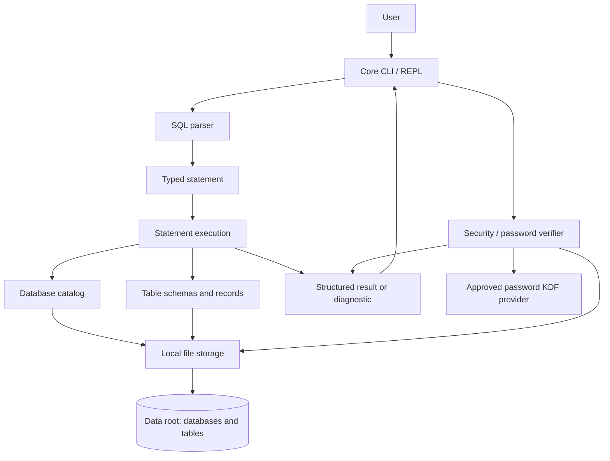

# Mini Database Engine: Technical Architecture

## Purpose and status

This document describes the target architecture for the official SPL-1 project
proposal. It is a design, not a claim that the features have already been
implemented.

The current program is a C++17 command-line shell with `HELP`, `EXIT`, and
`QUIT`, minimal command recognition, and data-directory creation. It does not
yet create or select databases, request passwords, manage tables, execute SQL,
or persist records.

## Official core requirements

The implementation must provide:

1. Password protection for databases.
2. Creation and management of multiple databases.
3. Multiple tables in a database.
4. Record insertion, viewing, updating, and deletion.
5. Basic SQL commands for database operations.
6. Local persistence across application restarts.

The selected implementation language is C++17, with VS Code as the development
environment and Git/GitHub for version control. These choices do not require a
particular SQL dialect, file encoding, or cryptography provider; those need to
be agreed before implementation.

## Design principles

- Keep the implementation understandable to a university student.
- Keep each module responsible for one concern and testable through its public
  interface.
- Use the C++ standard library where appropriate; do not add dependencies
  without a specific requirement.
- Treat user input, malformed database files, and filesystem failures as
  explicit errors.
- Do not store database passwords in plaintext or describe a weak general
  purpose hash as password protection.
- Keep the required SQL subset small. Foreign keys, joins, transactions,
  indexes, and advanced SQL are not required for acceptance.

## Proposed module boundaries

The existing top-level module layout is a useful starting point. Add a
`security` module because password protection is a required feature. Add source
and header files only when their behavior is ready to implement; the tree below
is a target, not a request to create empty placeholders.

```text
SPL-1/
├── CMakeLists.txt
├── README.md
├── .gitignore
├── data/                          # Runtime database files; ignored by Git
├── docs/
│   ├── ARCHITECTURE.md
│   ├── PROPOSAL_ALIGNMENT.md
│   └── ROADMAP.md
├── include/minidb/
│   ├── core/                      # CLI/application lifecycle
│   ├── execution/                 # SQL statement semantics
│   ├── parser/                    # Tokens, grammar, statement types
│   ├── security/                  # Credential verification interface
│   ├── storage/                   # Database catalog and table files
│   └── utils/                     # Shared diagnostics and small helpers
├── src/
│   ├── core/
│   ├── execution/
│   ├── parser/
│   ├── security/
│   ├── storage/
│   ├── utils/
│   └── main.cpp
└── tests/
    ├── CMakeLists.txt
    ├── parser_tests.cpp
    ├── security_tests.cpp
    ├── storage_tests.cpp
    └── execution_tests.cpp
```

Test files should be added alongside real behavior. A small project may combine
closely related tests rather than making one executable per source file.

## Module responsibilities

### Core (`core/`)

- Parse application options and run the command-line REPL.
- Coordinate authentication, parsing, execution, and results.
- Keep terminal input and output out of storage and SQL semantics.
- Route sensitive password entry through a concealed prompt, subject to the
  terminal/platform decision recorded in `PROPOSAL_ALIGNMENT.md`.

### Parser (`parser/`)

- Tokenize SQL input while preserving literal contents and source locations.
- Parse the supported SQL subset into typed statement structures.
- Recognize keywords without uppercasing or otherwise changing quoted data.
- Report unsupported syntax before execution or persistent changes.

The current parser is only a small command recognizer. It is not a SQL parser
and must not be extended by uppercasing complete SQL input, since that would
change case-sensitive text literals.

### Execution (`execution/`)

- Check statements against the selected database and table schemas.
- Implement database/table commands and the required record CRUD operations.
- Return structured results for the CLI to display.
- Depend on parser, storage, and security interfaces, not direct terminal or
  filesystem calls.

### Storage (`storage/`)

- Enumerate and manage database metadata and table files under the configured
  local data root.
- Serialize and validate schemas and records using a documented file format.
- Store each database's password verifier as metadata, separate from table
  records.
- Never store a recoverable plaintext password.
- Report I/O, corrupt-file, and unsupported-format errors explicitly.
- Use safe file-replacement practices for individual writes. This is an
  implementation reliability measure, not a requirement for multi-statement
  transactions or crash recovery.

### Security (`security/`)

- Provide the password creation and verification boundary to the application.
- Use a salted, purpose-built password key-derivation function with recorded
  parameters and constant-time verifier comparison.
- Do not implement a password KDF from scratch or silently fall back to a
  fast/general-purpose hash.
- Keep authentication state scoped to the current process/session.

The exact KDF/provider and its dependency implications require approval before
implementation. The C++17 standard library does not provide password hashing.
Database password protection is an access check; it does not, by itself,
encrypt data at rest.

### Utilities (`utils/`)

- Share small diagnostics and formatting helpers used by multiple modules.
- Avoid turning one-off behavior into generic frameworks.

### Build, tests, and runtime data

- CMake configures a C++17 executable and test targets.
- VS Code workspace configuration may be committed when it helps reproduce the
  build; `.vscode/` should not be ignored wholesale.
- Tests use temporary directories and do not depend on committed user data.
- The `data/` directory contains runtime databases and is ignored except for
  its directory marker.

## Dependency diagram



The diagram shows logical dependencies, not a requirement to create a class for
every box. The security provider must be selected before the `KDF` dependency
can be finalized.

## Database and table organization

Use one configured root directory for multiple named databases. A conceptual
layout is:

```text
data/
├── catalog
├── students_db/
│   ├── database_metadata
│   ├── students.table
│   └── courses.table
└── library_db/
    ├── database_metadata
    └── books.table
```

Names must be validated before they are mapped to paths. The catalog should
list databases, and each database's metadata should record its format version,
name, and password verifier. Table files should record their schema and rows.
Final names and encodings should be documented before storage implementation.

The database catalog and records must reload on a later application run.
Authentication must be required before a protected database is selected for
ordinary operations. The exact policy for listing names, changing passwords,
and handling an unprotected database remains a project decision; no extra
account or role system is implied.

## Minimum SQL command proposal

This list is a practical interpretation of “basic database operations” and is
subject to review. Keywords are case-insensitive; quoted text values are
preserved. One statement per input line is sufficient for the initial CLI.

| Requirement | Proposed command |
|---|---|
| Database creation | `CREATE DATABASE name;` (then concealed password setup) |
| Database listing | `SHOW DATABASES;` |
| Database selection | `USE name;` (then concealed password prompt) |
| Database removal | `DROP DATABASE name;` |
| Table listing | `SHOW TABLES;` |
| Table description | `DESCRIBE table_name;` |
| Table creation | `CREATE TABLE name (column type, ...);` |
| Table removal | `DROP TABLE name;` |
| Insert record | `INSERT INTO name VALUES (...);` |
| View records | `SELECT * FROM name [WHERE column operator value];` |
| Update records | `UPDATE name SET column = value [WHERE column operator value];` |
| Delete records | `DELETE FROM name [WHERE column operator value];` |
| Session help/exit | `HELP;`, `EXIT;`, `QUIT;` |

Candidate initial scalar types are `INTEGER`, `REAL`, `TEXT`, and `BOOLEAN`.
Candidate comparison operators are `=`, `!=`, `<`, `<=`, `>`, and `>=`.
Omitting `WHERE` from `UPDATE` or `DELETE` affects all records and must be
explained in help output. The exact grammar, identifier rules, password prompt
flow, and whether database drop requires an extra confirmation are review
decisions, not facts already implemented.

## Out of scope for core acceptance

Do not treat any of these as required:

- foreign keys or other relational constraints beyond what the agreed table
  model needs;
- `JOIN`;
- transactions, crash recovery, or concurrent clients;
- indexes or query optimization;
- advanced SQL such as subqueries, aggregates, compound predicates, or
  stored procedures;
- encryption of data at rest, user accounts, roles, or network access.

Any extension needs explicit scope agreement and must not delay the six core
requirements.
